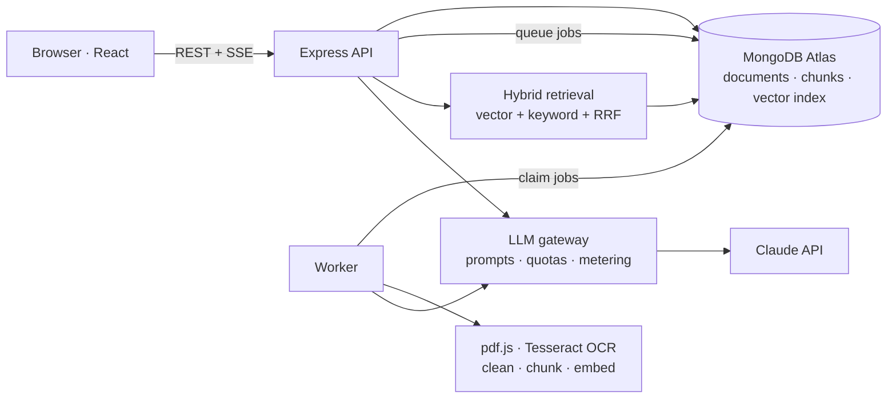

# StudyMate AI

**An AI study assistant that reads your lecture PDFs — typed or scanned — and answers questions with citations back to the exact page.**

Upload notes, then ask questions in a chat, or generate a summary, structured notes, key concepts, a quiz, or flashcards. Every answer and study item links to the pages it came from, and the assistant says so plainly when something isn't in your notes instead of making it up.


## Features

- **Any PDF:** typed text is extracted directly; scanned or broken pages are detected per page and read with OCR.
- **Grounded Q&A:** streaming answers with inline citations (`[S1]`) that open the PDF at the cited page; follow-up questions are understood in context.
- **Honest about gaps:** a relevance gate answers "not in your notes" for off-topic questions — without calling the LLM.
- **Study tools:** summary, study notes, key concepts, quizzes (with explanations and scoring), and flashcards — all page-linked.
- **Transparent processing:** see the exact passages the AI reads, with low-confidence OCR pages flagged.
- **Built to run:** background job queue with retries and crash recovery, per-user AI quotas, usage metering, rate limits.

## Architecture



The API stays fast because heavy work (PDF parsing, OCR, embeddings, long AI generations) runs in a separate worker process that claims jobs from MongoDB atomically. Answers come from **retrieval-augmented generation**: only the most relevant passages — never whole PDFs — are sent to the model, inside a fixed token budget.

More: [Architecture](docs/ARCHITECTURE.md) · [API](docs/API.md) · [Security](docs/SECURITY.md) · [Performance](docs/PERFORMANCE.md) · [Deployment](docs/DEPLOYMENT.md)

## Key engineering decisions

| Problem                     | Decision                                                                                                                          |
| --------------------------- | --------------------------------------------------------------------------------------------------------------------------------- |
| Mixed typed + scanned PDFs  | Per-page quality scoring (text / blank / scanned / garbled / image-heavy); OCR only where needed                                  |
| Long jobs vs. fast requests | MongoDB-backed job queue: atomic claims, heartbeats, stale-lock recovery, backoff, poison-job cap                                 |
| Retrieval quality           | Local `bge-small` embeddings + Atlas Vector Search + keyword search, fused with Reciprocal Rank Fusion; measured with hit@k / MRR |
| Hallucination               | Grounding rules, relevance gate, citation validation (invented sources are rejected and repaired)                                 |
| Reliable structured output  | Forced tool use with zod-generated JSON Schema, one repair turn, then a clean failure                                             |
| Cost                        | Cheap/smart model routing, map-reduce digest reused across tools, content-hash cache, selective prompt caching, per-user quotas   |
| Prompt injection            | Sources delimited as data, tag neutralization, validated outputs, and a model with no tools that act                              |
| Reprocessing safety         | Chunk generations swapped atomically under the job lock                                                                           |

## Tech stack

**Frontend:** React 19, React Router 7, TanStack Query, Tailwind CSS 4, Vite
**Backend:** Node.js, Express 5, Mongoose, zod, pino
**AI & documents:** Claude API, pdf.js, Tesseract.js, transformers.js (`bge-small-en-v1.5`), MongoDB Atlas Vector Search
**Quality:** Vitest, Supertest, mongodb-memory-server, Testing Library, Playwright, GitHub Actions

## Getting started

Prerequisites: Node 22.9+ (24 recommended), a MongoDB Atlas cluster (free tier works), and an Anthropic API key.

```bash
npm install
cp server/.env.example server/.env     # fill in MONGODB_URI, JWT_ACCESS_SECRET, ANTHROPIC_API_KEY
cp client/.env.example client/.env
npm run db:sync-indexes -w server      # regular indexes + the Atlas vector index
npm run seed:demo -w server            # optional: demo@studymate.app / studymate-demo-1
npm run dev                            # API :5050, worker, client :5173
```

No API key yet? Set `AI_PROVIDER=fake` to run everything except AI generation.

## Scripts

| Command                                                        | What it does                                                        |
| -------------------------------------------------------------- | ------------------------------------------------------------------- |
| `npm run dev`                                                  | API, worker, and client with hot reload                             |
| `npm test`                                                     | Server and client tests                                             |
| `npm run test:e2e`                                             | Playwright end-to-end test (needs local MongoDB)                    |
| `npm run lint` / `npm run format`                              | ESLint / Prettier                                                   |
| `npm run inspect-pdf -w server -- <file> [--ocr] [--chunks]`   | See how a PDF is classified, OCR'd, and chunked                     |
| `npm run eval:retrieval -w server -- <docId> <questions.json>` | Retrieval quality: hit@1/3/6, MRR, score gap for the relevance gate |
| `npm run eval:qa -w server -- <docId> <questions.json>`        | Answer quality vs. cost across context budgets and models           |
| `npm run eval:injection -w server -- <email>`                  | Prompt-injection red-team against the real model                    |
| `npm run usage:report -w server`                               | Cost, tokens, cache hits, p50/p95 latency per feature               |
| `npm run ai:smoke -w server -- <docId>`                        | One real LLM call end to end                                        |

## Project structure

```
client/src/
  api/          Axios client (silent token refresh), TanStack Query client
  features/     auth · documents · study · chat (each: api, hooks, components, pages)
  components/   UI primitives
server/src/
  routes → controllers → services → models     (controllers only see validated input)
  ai/           LLM gateway, providers, versioned prompts, retrieval, embeddings, digest
  processing/   pdf (extraction, quality) · ocr · text (normalize, chunk)
  jobs/         JobRunner (policy) · queues (persistence) · handlers
  storage/      local disk / GridFS adapters
  scripts/      indexes, evals, reports, seeding
server/tests/   unit · models · integration
e2e/            Playwright
```

## Limitations

- Handwriting OCR is unreliable (Tesseract targets print); low-confidence pages are flagged rather than trusted.
- Rate limits are per instance (in-memory store); multiple API instances would need a shared store.
- Access tokens remain valid up to 15 minutes after "log out everywhere" (stateless JWT trade-off).

## License

MIT
