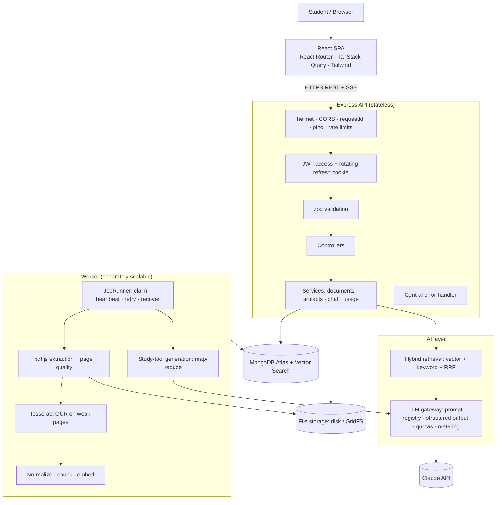

# Architecture

## System overview

## Request path: asking a question

1. `POST /conversations/:id/messages` → quota check → load recent turns.
2. **Query rewrite** (fast model) turns "why is it fast?" into a standalone query.
3. **Hybrid retrieval** over the conversation's documents: vector search (filtered by user and active chunk generation) + keyword search, fused with RRF.
4. **Relevance gate:** if the best vector score is below `QA_MIN_SCORE`, reply "not in your notes" — no LLM call.
5. **Context packing** into `QA_CONTEXT_TOKENS`, sources labelled `S1..Sn`.
6. **Streaming answer** (smart model) over SSE; `[S#]` markers mapped to document + page citations; message saved (complete / stopped / error).
7. Older turns are folded into a rolling summary so prompts stay bounded.

## Document pipeline (worker)

`queued → processing → ready | failed`, with progress per stage:

| Stage               | What happens                                                                                                               |
| ------------------- | -------------------------------------------------------------------------------------------------------------------------- |
| Extracting (0–10%)  | pdf.js text per page; each page classified text / blank / scanned / garbled / image-heavy                                  |
| OCR (10–70%)        | Only weak pages are rendered (DPI-capped) and OCR'd; merge rules pick native vs. OCR text; confidence recorded             |
| Chunking (70–72%)   | Unicode cleanup, header/footer removal, de-hyphenation, heading detection, ~400-token sentence-aligned chunks with overlap |
| Embedding (72–100%) | `bge-small-en-v1.5` (384-d) on section title + text                                                                        |
| Complete            | Insert a new chunk generation → swap atomically under the job lock → delete the losing generation                          |

## Study tools: map-reduce with a shared digest

- **Map** (fast model, once per document version): groups of chunks → section summaries + key points with pages. Stored as the document's digest.
- **Reduce** (one call per tool): digest → summary / notes / concepts / quiz / flashcards, every item citing digest sections → pages.
- **Cache key** = hash(content hash, type, options, prompt versions): repeats are free; reprocessing or a prompt change invalidates automatically.

## Data model

| Collection               | Purpose                                         | Key indexes                                                                           |
| ------------------------ | ----------------------------------------------- | ------------------------------------------------------------------------------------- |
| users                    | Accounts, AI limits                             | unique email                                                                          |
| refreshtokens            | Hashed refresh tokens, rotation families        | unique tokenHash, TTL on expiresAt                                                    |
| documents                | File facts, job state, extraction stats, digest | {userId, createdAt}, unique {userId, fileHash}, {status, lockedAt}                    |
| chunks                   | Passages + embeddings, by generation            | unique {documentId, generation, index}, text index {userId, text}, Atlas vector index |
| studyartifacts           | Generated study tools + job state               | unique {userId, cacheKey}, {documentId, type, createdAt}                              |
| conversations / messages | Chat                                            | {userId, lastMessageAt} / {conversationId, _id}                                       |
| aiusages                 | Every LLM call: tokens, cost, latency, outcome  | {userId, createdAt}, TTL 90 days                                                      |

## Design decisions (short ADRs)

- **MongoDB as the job queue** instead of Redis/BullMQ: one less service; atomic `findOneAndUpdate` claims, heartbeats and stale-lock reclaim give at-least-once processing. Upgrade path: BullMQ when throughput demands it.
- **Local embeddings** instead of an embeddings API: zero marginal cost, documents never leave the server; costs CPU and ~150 MB RAM per process. The 512-token model limit drove the 400-token chunk size.
- **Atlas Vector Search** instead of a separate vector DB: same database, pre-filters by user and generation; an exact-cosine backend serves tests and acts as a correctness baseline.
- **Forced tool use + zod** for structured output: schema in one place, validation plus one repair turn.
- **Single-origin production hosting** (API serves the built SPA): same-site cookies with `SameSite=Strict`, no CORS, SSE without proxy buffering.
